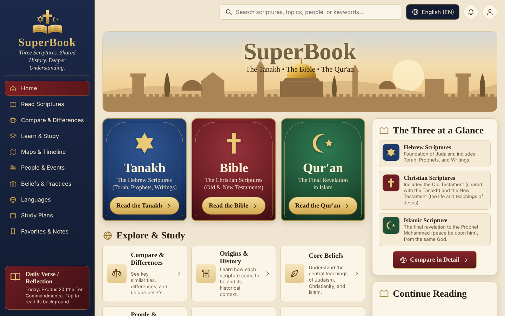
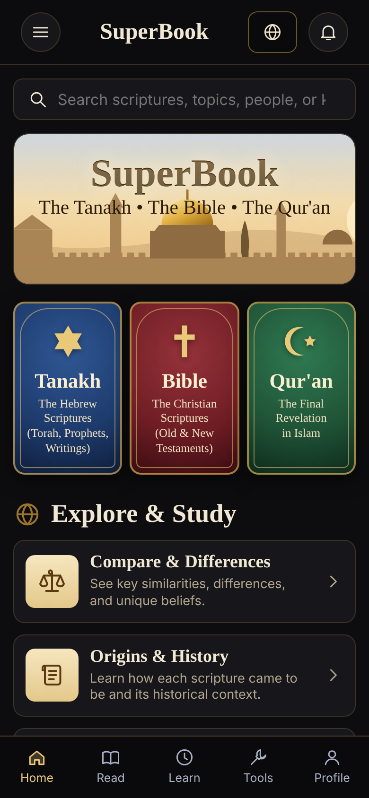

# SuperBook

**▶ [Live demo](https://theoyanvno.github.io/SuperBook/)**

A web app for reading and comparing the scriptures of the three Abrahamic faiths: the **Tanakh** (Judaism), the **Bible** (Christianity) and the **Qur'an** (Islam). Read any chapter in full, compare the three side by side, learn their history, beliefs and practice, follow a reading plan, and ask a question to see the answer written in the sand.

**Tech:** JavaScript (ES modules) · HTML · CSS · SVG · HTML Canvas · public REST APIs · `localStorage` · `node:test` · no frameworks

| Desktop | Phone |
|---|---|
|  |  |

## Features

- **Home:** a walled-city skyline at dusk, the three scriptures as cards (Tanakh in navy with the Star of David, the Bible in maroon with the cross, the Qur'an in green with the crescent and star), Explore & Study tiles, Key Differences at a Glance, The Three at a Glance and Continue Reading, which shows where you stopped in each scripture and how far through it you are. On a computer a sidebar lists every section, with a daily verse and its background; on a phone a bottom bar holds Home, Read, Learn, Tools and Profile.
- **Read all three in full**, chapter by chapter, from a book list with Tanakh, Bible and Qur'an tabs:
  - Tanakh in the Jewish order (Torah, Prophets, Writings), in English with the Hebrew original
  - Bible in the Eastern Orthodox canon and order: the Old Testament following the Septuagint, with Tobit, Judith, Wisdom of Solomon, Sirach, Baruch, 1–4 Maccabees, 1 Esdras, the Prayer of Manasseh, Susanna and Bel and the Dragon (books like 1 Samuel show their Orthodox names, "1 Kingdoms"), then the 27 books of the New Testament
  - Qur'an, all 114 surahs, in English with the Arabic original
- **The reader:** four text sizes, a bookmark, tap any verse to highlight it, notes for each chapter, read aloud (with the browser's speech), copy the chapter, and previous and next buttons that cross from book to book.
- **Compare & Learn:** the three side by side on 19 facts in four tabs (Overview, Beliefs, Structure, History), with deeper topics under each.
- **Learn:** Origins & History, Key Beliefs, Major Differences, Similarities and How They Are Used Today, plus People & Events and Beliefs & Practices pages. Every topic shows what each tradition teaches (76 topics in all).
- **Study Tools:** Commentary (study questions for 300 chapters and surahs), Maps (12 key places, what each means in each tradition, and a map link), a Timeline of 22 key dates, 30 Key Terms & Definitions, People & Places, and Historical Context for well-known passages.
- **Reading Plans:** Foundations, a Comparison Plan that reads the shared stories side by side (creation, Noah, Abraham, Joseph, Moses, Mary and Jesus, Jonah, one God), a 30-Day Overview, a 90-Day Deep Study, and a Custom Plan for any book at your own pace. Tick off each reading, or mark it done from the reader.
- **Ask the sand:** type a question in the search box and the answer is carved into the sand letter by letter. Book and chapter names ("John 3", "Surah 36") also jump straight to the reader. The sand covers 76 topics, each answered separately for the Tanakh, the Bible and the Qur'an:
  - **The books:** how they differ, how old they are, who wrote them, where, original languages and translations, how they're organized, the longest and shortest chapters, first and last words, famous passages, the oldest manuscripts, which books are included, the Gospels, other sacred writings (Talmud, Hadith) and interpretation
  - **People:** God and the names of God, the Holy Spirit, Jesus, Muhammad, the prophets, Abraham, Moses, Noah, Joseph, David and Solomon, Jonah, John the Baptist, Mary, Paul and women in the scriptures
  - **Beliefs:** creation, Satan, angels and jinn, miracles, the Messiah, the end of days, the afterlife, sin and salvation, repentance, free will, suffering, covenant, ethics, peace and war, and how the faiths see each other
  - **Practice:** law, the Ten Commandments, prayer, places of worship and leaders, holy days, the Sabbath, fasting, charity, pilgrimage, holy places, food, money, marriage, funerals, circumcision and baptism, conversion, dress, art, calendars, greetings and followers today
- **Harder questions**: which books are in one scripture but not another, how the stories the Bible and the Qur'an share are told differently, and the historical context behind a passage ("What is the historical context of Psalm 137?", "Why was Surah 96 revealed?").
- **Favorites & Notes:** your bookmarks, highlights and notes in one place, plus settings: light, dark or match your device, and optional desert ambience music.
- **Eight languages**: English, Spanish, French, German, Hebrew, Arabic, Greek and Latin, chosen from the language menu or the Languages page. The answers, passages, study guide and comparison table are translated, and you can ask questions in the language you picked. Hebrew and Arabic switch the layout to right-to-left. Some of the newest page labels are still in English in the other languages.
- Saved on your device only, works on phones and computers, supports reduced-motion settings, and screen readers get every answer as text.

Older links still work: `?book=Psalms&chapter=23` (or `?read=tanakh` / `?read=quran`) opens the reader at that chapter. Inside the app, every page has its own link, such as `#reader/bible/John/3`.

## Where the texts come from

The app doesn't store any scripture. Each chapter is loaded when you open it, from free public APIs, using **public-domain translations**:

| Book | Translation | Source |
|---|---|---|
| Tanakh | *The Holy Scriptures* (JPS 1917), with Hebrew from *Miqra according to the Masorah* (CC BY-SA) | [Sefaria](https://www.sefaria.org) |
| Holy Bible | World English Bible (public domain), which includes the books Protestant Bibles leave out | [bible-api.com](https://bible-api.com) |
| Qur'an | Marmaduke Pickthall (1930), with the Arabic Uthmani text | [alquran.cloud](https://alquran.cloud) |

### In other languages

Where a free, public-domain translation exists, the reader loads it in the language you picked. Where none exists, it shows the English text with a note saying so.

| Language | Tanakh | Holy Bible | Qur'an |
|---|---|---|---|
| Spanish | English (JPS 1917) | Reina-Valera 1909 | English (Pickthall) + Arabic |
| French | Bible du Rabbinat 1899 | Louis Segond 1910 | English (Pickthall) + Arabic |
| German | Zunz Bible (1838) | Elberfelder 1871 | English (Pickthall) + Arabic |
| Hebrew | Hebrew only | Hebrew Old Testament (Westminster Leningrad Codex); New Testament in English | English (Pickthall) + Arabic |
| Arabic | English (JPS 1917) + Hebrew | English (WEB) | Arabic |
| Greek | English (JPS 1917) + Hebrew | Septuagint and Tischendorf's Greek New Testament | English (Pickthall) + Arabic |
| Latin | English (JPS 1917) + Hebrew | Clementine Vulgate | English (Pickthall) + Arabic |

Translations come from [getbible.net](https://getbible.net) and [Sefaria](https://www.sefaria.org). The Orthodox books outside the 66-book Protestant canon (Tobit, Judith, Maccabees and others) are always shown from the English World English Bible. The Greek and Latin Bibles number the Psalms the Septuagint and Vulgate way (Psalm 23 is their Psalm 22). No public-domain Qur'an translation exists in these languages, so the Qur'an stays in English with the Arabic beside it.

**About the translations:** the site's text in the seven other languages was translated with help from AI tools and hasn't yet been checked by fluent readers. Corrections, especially for Hebrew, Arabic, Greek and Latin, are welcome.

The free Bible source doesn't have the Letter of Jeremiah, Psalm 151 or the Greek additions to Esther and Daniel (except Susanna and Bel), so those are the only parts of the Orthodox Bible missing from the reader.

## Link to a chapter

Any page can open SuperBook's reader at one chapter, which is how other projects link a passage here:

| Link | Opens |
| --- | --- |
| [`?book=Psalms&chapter=23`](https://theoyanvno.github.io/SuperBook/?book=Psalms&chapter=23) | Psalm 23 in the Bible |
| [`?book=1 Kingdoms&chapter=3`](https://theoyanvno.github.io/SuperBook/?book=1%20Kingdoms&chapter=3) | 1 Kingdoms (1 Samuel) 3: a book can be named by its id, its label or either name in the label |
| [`?read=tanakh&book=Genesis&chapter=1`](https://theoyanvno.github.io/SuperBook/?read=tanakh&book=Genesis&chapter=1) | Genesis 1 in the Tanakh |
| [`?read=quran&book=36`](https://theoyanvno.github.io/SuperBook/?read=quran&book=36) | Surah 36 |

The address updates as you turn pages, so a chapter can be shared as it is. A chapter that doesn't exist opens chapter 1, and an unknown book opens the first one. `src/links.js` reads and builds these links.

## How it's built

| File | What it does |
|---|---|
| [`src/books.js`](src/books.js) | Table of contents for each book and the API calls that load a chapter |
| [`src/topics.js`](src/topics.js) | 76 topics, each with a short answer per book and the keywords that point to it |
| [`src/passages.js`](src/passages.js) | Historical context for 20 well-known passages, from Genesis 1 and Psalm 137 to John 3:16 and Surah 96 |
| [`src/studydata.js`](src/studydata.js) | The workbook's chapters, study questions and suggested answers. The workbook reuses the same ten answers in the same order for all three scriptures; they fit the Bible questions, and `FIT` pairs each Torah and Qur'an question with the answer that matches it |
| [`src/study.js`](src/study.js) | Finds a chapter or surah in a question ("Genesis 12", "chapter 12 of Genesis", "Surah Baqarah", "Al-Mulk"), decides which scripture it means, works out the kind of question and builds the answer |
| [`src/answers.js`](src/answers.js) | Question matcher: normalizes spellings (Koran → Qur'an), stems words (prophets → prophet), detects which books a question names, scores topics (specific keywords outweigh general ones) and builds the answer |
| [`src/facts.js`](src/facts.js) | The facts in the side-by-side comparison table |
| [`src/sand.js`](src/sand.js) | Canvas animation that writes text as grooves in the sand, with flying grains and a wind-sweep effect |
| [`src/music.js`](src/music.js) | Optional desert ambience, generated in the browser |
| [`src/i18n.js`](src/i18n.js) | The language list, the English page text, and lookups that use the chosen language's pack, falling back to English |
| [`src/lang/`](src/lang) | One pack per language: page text, book names, all 76 topics, passages, facts, study guide, and the local words the question matcher listens for |
| [`src/text.js`](src/text.js) | Normalizes questions in any language (accents, Greek final sigma, Arabic letter forms, Hebrew and Arabic prefixes) and maps local book names to English |
| [`src/app.js`](src/app.js) | Every page (home, read, reader, compare, learn, tools, plans, languages, favorites, ask), hash routing, theme and language menus |
| [`src/learn.js`](src/learn.js) | How the 76 topics group into Learn, People & Events, Beliefs & Practices and the Compare tabs |
| [`src/tools.js`](src/tools.js) | Key terms, places, the timeline and the reading plans |
| [`src/store.js`](src/store.js) | Where you stopped, bookmarks, highlights, notes, plan progress and settings, saved in the browser |
| [`src/ui-text.js`](src/ui-text.js) | English text for the pages; language packs can translate any of it |

## Run it

```bash
python3 -m http.server 8000      # then open http://localhost:8000 (needs internet to load the texts)
npm test                         # 32 tests, including 131 sample English questions and samples in every language routed to the right topic and books
```

It can also be published for free with GitHub Pages (Settings → Pages → deploy from the `main` branch).

## A note on the answers

The comparisons are short, neutral summaries of what each tradition generally teaches. Every faith has a wide range of views within it, so treat them as a starting point, not the final word.

Built with help from AI coding tools for planning, code review and tests.

## License

MIT. See [LICENSE](LICENSE).
