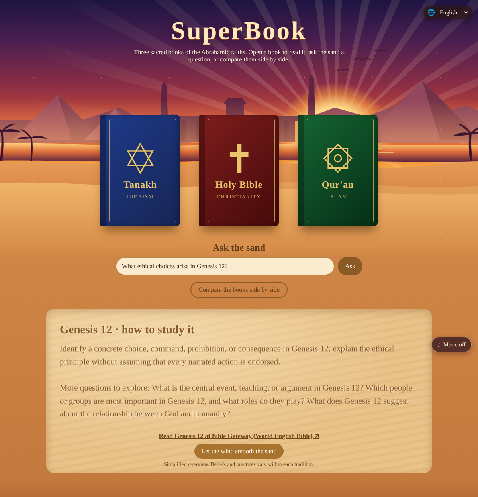
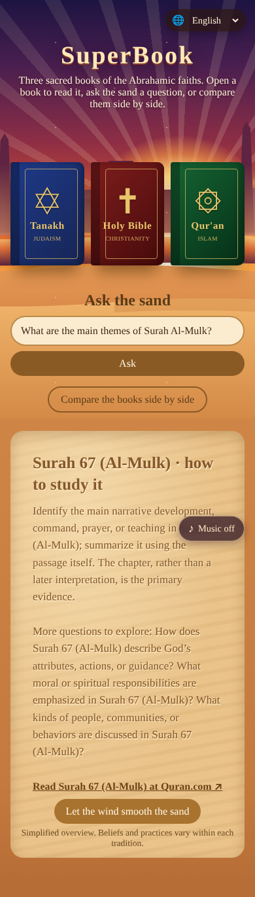

# SuperBook

**▶ [Live demo](https://theoyanvno.github.io/SuperBook/)**

A web app for exploring the scriptures of the three Abrahamic faiths. Three books rest in a desert: the **Tanakh** (Judaism), the **Holy Bible** (Christianity) and the **Qur'an** (Islam). Click a book to open and read the complete text, chapter by chapter. Ask how the books differ, and the answer is written into the sand.

**Tech:** JavaScript (ES modules) · HTML Canvas · CSS animations · public REST APIs · `node:test` · no frameworks

| Desktop | Phone |
|---|---|
|  |  |

## Features

- **Read all three books in full**, with book/surah and chapter pickers and next/previous buttons
  - Tanakh in the Jewish order (Torah, Prophets, Writings), in English with the Hebrew original
  - Holy Bible, all 66 books of the Old and New Testaments
  - Qur'an, all 114 surahs, in English with the Arabic original
- **Covers** use each faith's widely recognized symbol: the Star of David, the cross, and the eight-pointed star (Rub el Hizb) that marks sections of the Qur'an
- **Ask the sand**: type a question (or tap a suggestion) about how the books and faiths differ (God, Jesus, Muhammad, Moses, Abraham, Mary, structure, languages, afterlife, law, prayer, holy days, holy places, food) and the answer is carved into the sand letter by letter. A gust of wind smooths it away.
- Works on phones, supports reduced-motion settings, and screen readers get the answer as text

## Where the texts come from

The app doesn't store any scripture. Each chapter is loaded when you open it, from free public APIs, using **public-domain translations**:

| Book | Translation | Source |
|---|---|---|
| Tanakh | *The Holy Scriptures* (JPS 1917), with Hebrew from *Miqra according to the Masorah* (CC BY-SA) | [Sefaria](https://www.sefaria.org) |
| Holy Bible | King James Version (1611) | [bible-api.com](https://bible-api.com) |
| Qur'an | Marmaduke Pickthall (1930), with the Arabic Uthmani text | [alquran.cloud](https://alquran.cloud) |

## How it's built

| File | What it does |
|---|---|
| [`src/books.js`](src/books.js) | Table of contents for each book and the API calls that load a chapter |
| [`src/answers.js`](src/answers.js) | Comparison topics and the keyword matcher that picks the best answer for a question |
| [`src/sand.js`](src/sand.js) | Canvas animation that writes text as grooves in the sand, with flying grains and a wind-sweep effect |
| [`src/app.js`](src/app.js) | Book reader (with caching), question form and page wiring |

## Run it

```bash
python3 -m http.server 8000      # then open http://localhost:8000 (needs internet to load the texts)
npm test                         # tests for the question matcher and book tables
```

It can also be published for free with GitHub Pages (Settings → Pages → deploy from the `main` branch).

## A note on the answers

The comparisons are short, neutral summaries of what each tradition generally teaches. Every faith has a wide range of views within it, so treat them as a starting point, not the final word.

Built with help from AI coding tools for planning, code review and tests.
